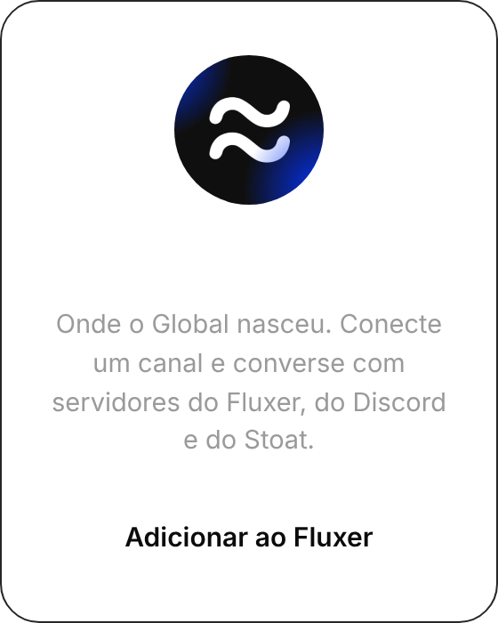
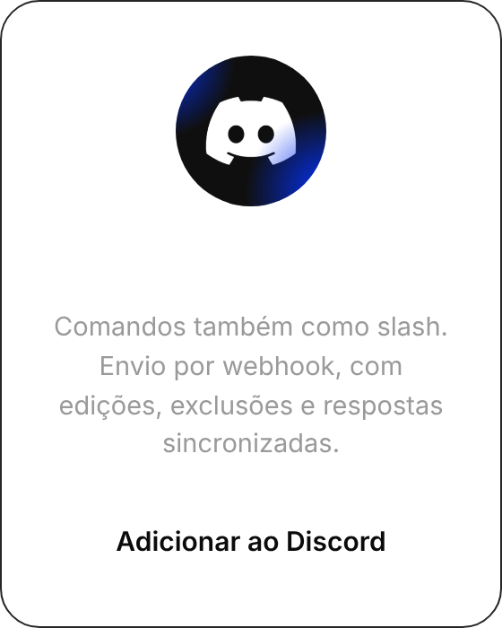
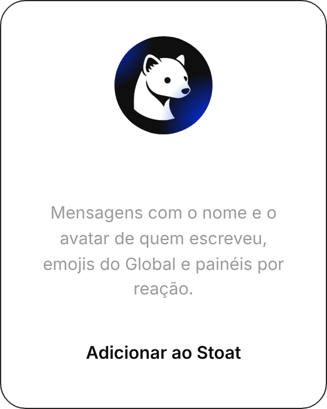

<div align="center">


<br>
<br>

[](https://globalbot.site)
[](https://github.com/globaloficial/global)
[](https://vercel.com)

</div>

---

<div align="center">

<picture><source media="(prefers-color-scheme: light)" srcset="assets/readme/t-sobre-light.png"></picture>

<br>

Este é o site do Global, o chat que liga o Fluxer, o Discord e o Stoat.<br>
Tem a página inicial, os parceiros, as estatísticas, os comandos, a documentação, o suporte e o painel de configuração.

<br>

<sub>Este repositório é só o site. O código do bot fica em <a href="https://github.com/globaloficial/global">globaloficial/global</a>.</sub>

</div>

---

<div align="center">

<picture><source media="(prefers-color-scheme: light)" srcset="assets/readme/t-paginas-light.png"></picture>

<br>

| Página | Para que serve |
| --- | --- |
| `index.html` | Página inicial, com a apresentação do Global |
| `parceiros.html` | Comunidades parceiras |
| `estatisticas.html` | Números do bot em tempo real |
| `comandos.html` | Todos os comandos, por plataforma |
| `docs/` | Documentação e política de privacidade |
| `support/` | Central de suporte, FAQ e conversas com a equipe |
| `dash/` | Painel web de configuração |

</div>

---

<div align="center">

<picture><source media="(prefers-color-scheme: light)" srcset="assets/readme/t-estatisticas-light.png"></picture>

<br>

A página de estatísticas lê os números de <code>api.globalbot.site/stats</code>,<br>
que é servida pelo próprio bot.

</div>

---

<div align="center">

<picture><source media="(prefers-color-scheme: light)" srcset="assets/readme/t-local-light.png"></picture>

<br>

O site é HTML, CSS e JavaScript puro, sem etapa de build. Basta servir a pasta.

</div>

```sh
git clone https://github.com/globaloficial/global_site
cd global_site
npx serve .
```

---

<div align="center">

<picture><source media="(prefers-color-scheme: light)" srcset="assets/readme/t-parceiros-light.png"></picture>

<br>

Os parceiros ficam em <code>js/partners-data.js</code> e as imagens em <code>assets/partners</code>.<br>
Para incluir um, adicione o item na lista e coloque a imagem na pasta.

</div>

---

<div align="center">

<picture><source media="(prefers-color-scheme: light)" srcset="assets/readme/t-estrutura-light.png"></picture>

</div>

```
global_site/
├── index.html
├── parceiros.html
├── estatisticas.html
├── comandos.html
├── vercel.json
├── css/
├── js/
├── dash/
├── docs/
├── support/
└── assets/
```

---

<div align="center">

<picture><source media="(prefers-color-scheme: light)" srcset="assets/readme/t-adicionar-light.png"></picture>

<br>

<a href="https://web.fluxer.app/oauth2/authorize?client_id=1562253521942745089&scope=bot&permissions=4503600164629568"><picture><source media="(prefers-color-scheme: light)" srcset="assets/readme/c-fluxer-light.png"></picture></a>&nbsp;&nbsp;
<a href="https://discord.com/oauth2/authorize?client_id=1570965038087413971&permissions=2252764571102209&integration_type=0&scope=applications.commands+bot"><picture><source media="(prefers-color-scheme: light)" srcset="assets/readme/c-discord-light.png"></picture></a>&nbsp;&nbsp;
<a href="https://stoat.chat/bot/01M7ZPBRQA2YZXZMYHFF1D65P6"><picture><source media="(prefers-color-scheme: light)" srcset="assets/readme/c-stoat-light.png"></picture></a>

<br>
<br>

[](https://github.com/xMqRs)
[](https://github.com/xMqRs)

</div>
