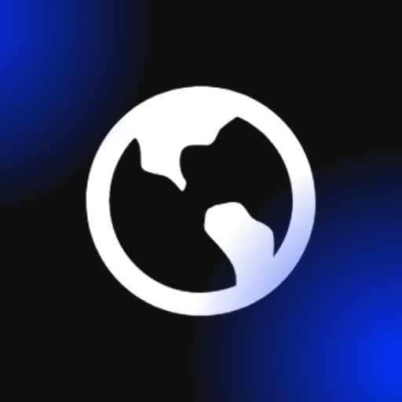
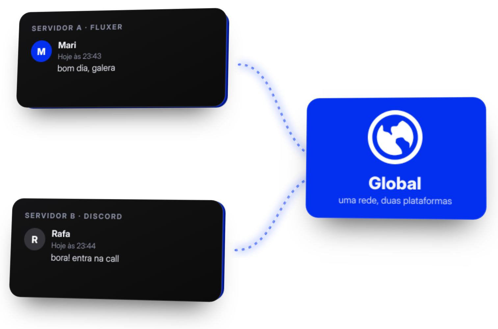
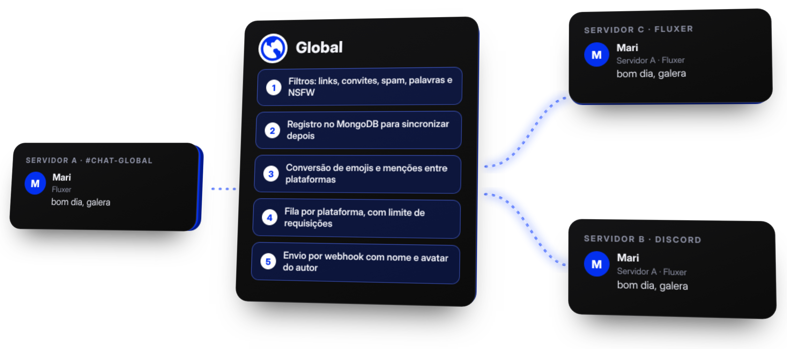

<div align="center">

<a href="https://globalbot.site"></a>

# Global

O site do chat que liga o Fluxer e o Discord.

[](https://globalbot.site)
[](https://github.com/globaloficial/global)
[](https://vercel.com)

<br>



</div>

<br>

> Este repositório é só o site. O código do bot fica em [globaloficial/global](https://github.com/globaloficial/global).

<br>

<h2 align="center">O que tem aqui</h2>

<div align="center">

| Página | Para que serve |
| --- | --- |
| `index.html` | Página inicial, com a apresentação do Global |
| `parceiros.html` | Comunidades parceiras |
| `estatisticas.html` | Números do bot em tempo real |
| `comandos.html` | Todos os comandos, por plataforma |
| `docs/` | Documentação e política de privacidade |
| `support/` | Central de suporte, FAQ e conversas com a equipe |
| `dash/` | Painel web de configuração |

</div>

<br>

<h2 align="center">Como a mensagem chega</h2>

<div align="center">

</div>

<br>

<h2 align="center">Estatísticas</h2>

<p align="center">
A página de estatísticas lê os números de <code>api.globalbot.site/stats</code>,<br>
que é servida pelo próprio bot.
</p>

<br>

<h2 align="center">Rodando localmente</h2>

<p align="center">O site é HTML, CSS e JavaScript puro, sem etapa de build. Basta servir a pasta:</p>

```sh
git clone https://github.com/globaloficial/global_site
cd global_site
npx serve .
```

<br>

<h2 align="center">Parceiros</h2>

<p align="center">
Os parceiros ficam em <code>js/partners-data.js</code> e as imagens em <code>assets/partners</code>.<br>
Para incluir um, adicione o item na lista e coloque a imagem na pasta.
</p>

<br>

<h2 align="center">Estrutura</h2>

```
global_site/
├── index.html
├── parceiros.html
├── estatisticas.html
├── vercel.json
├── css/
├── js/
├── docs/
└── assets/
```

<br>

<h2 align="center">Cores</h2>

<div align="center">

| Uso | Cor |
| --- | --- |
| Oficial |  |
| Fundo |  |
| Cartões |  |

</div>

<br>

<p align="center">Criado por xMqR · Apoiado financeiramente por Joao.</p>
